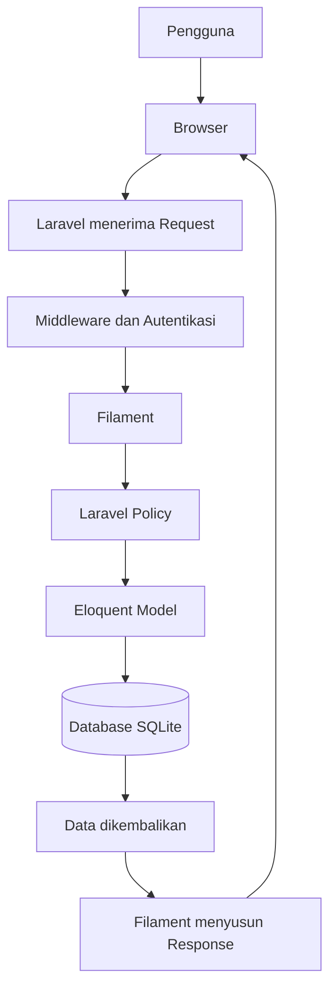
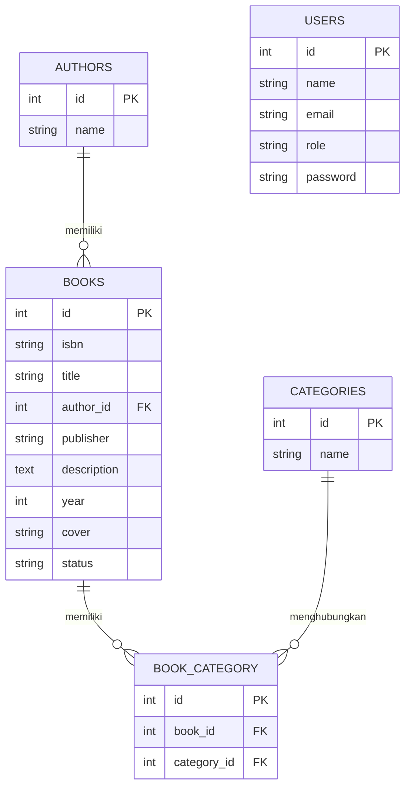

# 📘 Laporan Praktikum Pertemuan Ke-8

🧑‍🎓 **Reevan Azepha Islamy Iskandar — 4524210083**

# 📚 AuthBook — Sistem Manajemen Perpustakaan

AuthBook merupakan aplikasi website berbasis Laravel yang dikembangkan untuk membantu pengelolaan data perpustakaan. Aplikasi ini menyediakan dashboard administrasi menggunakan Filament untuk mengelola data buku, penulis, kategori, dan pengguna.

Pada Praktikum 8, dilakukan analisis dan dokumentasi terhadap aplikasi AuthBook. Pembahasan meliputi arsitektur aplikasi, hubungan antar tabel, alur request hingga response, serta perbandingan pembuatan CRUD menggunakan Filament dan cara manual.

Aplikasi menggunakan database SQLite untuk menyimpan seluruh data.

<p align="center">
  
  
  
  
  
</p>

## 📋 Daftar Isi

- [Tentang Aplikasi](#-tentang-aplikasi)
- [Fitur Utama](#-fitur-utama)
- [Tech Stack](#-tech-stack)
- [Persyaratan Sistem](#-persyaratan-sistem)
- [Instalasi](#-instalasi)
- [Konfigurasi Database](#-konfigurasi-database)
- [Penggunaan Aplikasi](#-penggunaan-aplikasi)
- [Arsitektur Aplikasi](#-arsitektur-aplikasi)
- [Entity Relationship Diagram](#-entity-relationship-diagram)
- [Flow Aplikasi](#-flow-aplikasi)
- [Perbandingan CRUD](#-perbandingan-crud-filament-dan-manual)
- [Refleksi Pembelajaran](#-refleksi-pembelajaran)
- [Struktur Project](#-struktur-project)
- [Testing](#-testing)
- [Penutup](#-penutup)

## 🎯 Tentang Aplikasi

AuthBook adalah aplikasi manajemen perpustakaan sederhana yang dibangun menggunakan Laravel 12 dan Filament 3.

Aplikasi ini menyediakan dashboard administrasi untuk mengelola informasi buku, penulis, dan kategori. Selain itu, terdapat sistem role pengguna yang membedakan hak akses Admin, Staff, dan Viewer.

Pada Praktikum 8, proyek ini digunakan sebagai bahan analisis untuk memahami arsitektur aplikasi Laravel, relasi database, proses request dan response, serta perbandingan penggunaan Filament dengan pembuatan CRUD secara manual.

## ✨ Fitur Utama

- 📚 **Manajemen Buku** — Menambahkan, melihat, mengubah, dan menghapus data buku.
- 📝 **Deskripsi Buku** — Menyimpan informasi mengenai buku.
- ✍️ **Manajemen Penulis** — Mengelola data penulis.
- 🏷️ **Manajemen Kategori** — Mengelola kategori buku.
- 🔗 **Relasi Buku dan Kategori** — Satu buku dapat memiliki beberapa kategori.
- 🖼️ **Upload Sampul Buku** — Mengunggah gambar sampul buku.
- 🔐 **Role Management** — Membagi pengguna menjadi Admin, Staff, dan Viewer.
- 🛡️ **Authorization Policy** — Mengatur izin pengguna berdasarkan role.
- 📊 **Dashboard Statistik** — Menampilkan informasi jumlah buku dan penulis.
- 📈 **Grafik Status Buku** — Menampilkan perbandingan buku Available dan Borrowed.
- 🗄️ **Database SQLite** — Menyimpan data aplikasi menggunakan database SQLite.

## 🛠️ Tech Stack

### Backend
- Laravel 12.x
- PHP 8.2+
- Eloquent ORM
- Laravel Policy

### Admin Panel
- Filament 3.x
- Filament Resource
- Filament Widgets

### Frontend
- Blade Template
- Tailwind CSS 4.0
- Vite 7
- JavaScript

### Database
- SQLite
- Laravel Migration
- Database Seeder

### Development Tools
- Composer
- Node.js dan npm
- PHP Artisan
- PHPUnit

## 💻 Persyaratan Sistem

Sebelum menjalankan aplikasi, pastikan perangkat telah memiliki:

- PHP versi 8.2 atau lebih baru.
- Composer.
- Node.js dan npm.
- Git.
- Ekstensi PHP yang dibutuhkan Laravel dan Filament, termasuk `intl`.

## 🚀 Instalasi

### 1. Clone Repository

Ganti URL berikut dengan URL repository Praktikum 8 yang sebenarnya.

```bash
git clone URL_REPOSITORY_PRAKTIKUM_8
```

Masuk ke direktori repository:

```bash
cd NAMA_FOLDER_REPOSITORY
```

Masuk ke folder aplikasi Laravel:

```bash
cd authbook-tugas2_testing
```

### 2. Install Dependencies

Install dependensi PHP:

```bash
composer install
```

Install dependensi frontend:

```bash
npm install
```

### 3. Setup Environment

Salin file `.env.example` menjadi `.env`.

Untuk Git Bash:

```bash
cp .env.example .env
```

Untuk Windows Command Prompt:

```cmd
copy .env.example .env
```

Generate application key:

```bash
php artisan key:generate
```

### 4. Konfigurasi Database SQLite

Buka file `.env` dan pastikan konfigurasi database menggunakan SQLite:

```env
DB_CONNECTION=sqlite
```

Pastikan file database tersedia pada lokasi:

```text
database/database.sqlite
```

Jika file belum tersedia, buat file kosong dengan nama `database.sqlite` di dalam folder `database`.

### 5. Jalankan Migration

```bash
php artisan migrate
```

Migration akan membuat tabel yang diperlukan, seperti:

- users
- authors
- books
- categories
- book_category
- cache
- jobs

### 6. Jalankan Database Seeder

```bash
php artisan db:seed
```

Seeder akan membuat akun pengguna, kategori, data penulis, dan data buku contoh.

### 7. Hubungkan Storage

```bash
php artisan storage:link
```

### 8. Jalankan Aplikasi

Jalankan frontend:

```bash
npm run dev
```

Jalankan server Laravel pada terminal terpisah:

```bash
php artisan serve
```

Buka browser dan akses:

```text
http://127.0.0.1:8000/admin
```

## 👤 Akun Pengguna

Setelah menjalankan database seeder, tersedia tiga akun contoh berikut:

| Role | Email | Password |
|---|---|---|
| Admin | admin@example.com | password |
| Staff | staff@example.com | password |
| Viewer | viewer@example.com | password |

## 🌐 Penggunaan Aplikasi

1. Jalankan aplikasi menggunakan perintah `php artisan serve`.
2. Buka halaman admin Filament melalui browser.
3. Login menggunakan salah satu akun yang tersedia.
4. Masuk ke dashboard untuk melihat statistik perpustakaan.
5. Pilih menu Books untuk mengelola data buku.
6. Pilih menu Authors untuk mengelola data penulis.
7. Pilih menu Categories untuk mengelola kategori buku.
8. Coba login menggunakan role yang berbeda untuk melihat perbedaan hak akses.

## 🏗️ Arsitektur Aplikasi

Aplikasi AuthBook menggunakan Laravel sebagai framework utama dan Filament sebagai admin panel.

Secara umum, pembagian tugasnya adalah:

- **Browser:** Tempat pengguna mengakses aplikasi.
- **Laravel:** Menerima request, menjalankan proses aplikasi, dan mengembalikan response.
- **Middleware:** Memeriksa autentikasi dan sesi pengguna.
- **Filament Resource:** Menyediakan halaman pengelolaan data.
- **Laravel Policy:** Memeriksa hak akses pengguna.
- **Eloquent Model:** Menghubungkan aplikasi dengan tabel database.
- **SQLite:** Menyimpan data aplikasi.

### Alur Request hingga Response



## 🗄️ Entity Relationship Diagram

Database AuthBook memiliki tabel utama users, authors, books, categories, dan book_category.



### Penjelasan Relasi

| Relasi | Jenis | Keterangan |
|---|---|---|
| Authors – Books | One to Many | Satu penulis dapat memiliki banyak buku. |
| Books – Categories | Many to Many | Satu buku dapat memiliki beberapa kategori. |
| Books – Book_Category | One to Many | Tabel penghubung menyimpan relasi buku dengan kategori. |
| Categories – Book_Category | One to Many | Satu kategori dapat digunakan oleh banyak buku. |

Tabel `book_category` merupakan tabel pivot yang menghubungkan tabel `books` dan `categories`.

Tabel `users` digunakan untuk menyimpan akun pengguna dan role. Tabel ini tidak memiliki relasi foreign key langsung dengan tabel perpustakaan lainnya.

## 🔄 Flow Aplikasi

Proses aplikasi dimulai ketika pengguna membuka halaman admin melalui browser. Laravel menerima request, kemudian memeriksa autentikasi dan hak akses pengguna.

Setelah pengguna berhasil login, Filament memproses halaman yang diminta. Jika membutuhkan data, Filament berinteraksi dengan model Eloquent untuk mengambil atau menyimpan data ke database SQLite.

Hasil pemrosesan kemudian dikembalikan kepada browser dalam bentuk response.

## ⚖️ Perbandingan CRUD Filament dan Manual

| Aspek | Filament | Manual |
|---|---|---|
| Pembuatan CRUD | Lebih cepat | Membutuhkan lebih banyak langkah |
| Form input | Menggunakan komponen tersedia | Membuat form sendiri |
| Tabel data | Menggunakan Table Builder | Membuat tabel sendiri |
| Tampilan | Mengikuti komponen Filament | Lebih bebas |
| Hak akses | Dapat menggunakan Laravel Policy | Mengatur pemeriksaan akses sendiri |
| Fleksibilitas | Mengikuti struktur Filament | Lebih fleksibel |

### Kelebihan Filament
- Mempercepat pembuatan CRUD.
- Menyediakan komponen form dan tabel.
- Memiliki tampilan admin yang terstruktur.
- Terintegrasi dengan Laravel dan Eloquent.

### Kekurangan Filament
- Tampilan mengikuti struktur Filament.
- Perlu memahami cara kerja Filament.
- Penyesuaian tertentu membutuhkan pemahaman lebih lanjut.

### Kelebihan CRUD Manual
- Tampilan dapat disesuaikan dengan kebutuhan.
- Alur program lebih bebas.
- Membantu memahami proses CRUD secara langsung.

### Kekurangan CRUD Manual
- Membutuhkan waktu pengerjaan lebih lama.
- Harus membuat form, tabel, validasi, dan tampilan sendiri.
- Kode yang dibuat bisa lebih banyak.

Filament cocok digunakan untuk aplikasi yang membutuhkan dashboard administrasi dan pengelolaan data secara cepat. Sementara itu, CRUD manual lebih cocok ketika aplikasi membutuhkan tampilan dan alur kerja yang sangat khusus.

## 📝 Refleksi Pembelajaran

### 1. Hal yang Dipelajari

Melalui praktikum ini, saya mempelajari cara kerja arsitektur aplikasi Laravel, hubungan antar tabel menggunakan ERD, serta proses request hingga response.

Saya juga memahami perbedaan pembuatan CRUD menggunakan Filament dan cara manual. Dari perbandingan tersebut, saya mengetahui bahwa setiap pendekatan memiliki kelebihan dan kekurangan sesuai kebutuhan aplikasi.

### 2. Kesulitan yang Dihadapi

Beberapa kesulitan yang dihadapi selama pengerjaan proyek antara lain:

- Konfigurasi database SQLite.
- Memahami relasi one-to-many dan many-to-many.
- Memahami penggunaan Laravel Policy.
- Menyesuaikan komponen Filament dengan kebutuhan aplikasi.

Kesulitan tersebut diatasi dengan memeriksa konfigurasi, mempelajari dokumentasi Laravel dan Filament, serta mencoba menjalankan fitur secara bertahap.

### 3. Rencana Pengembangan

Beberapa rencana pengembangan aplikasi AuthBook selanjutnya adalah:

1. Menambahkan fitur peminjaman dan pengembalian buku.
2. Menambahkan pencarian buku berdasarkan judul dan penulis.
3. Menambahkan riwayat peminjaman.
4. Membuat laporan data buku.
5. Menambahkan notifikasi keterlambatan pengembalian.

## 📂 Struktur Project

```text
authbook-tugas2_testing/
├── app/
│   ├── Filament/
│   │   ├── Resources/
│   │   │   ├── AuthorResource.php
│   │   │   ├── BookResource.php
│   │   │   └── CategoryResource.php
│   │   └── Widgets/
│   │       ├── BookStatusChart.php
│   │       └── LibraryStatsOverview.php
│   ├── Models/
│   │   ├── Author.php
│   │   ├── Book.php
│   │   ├── Category.php
│   │   └── User.php
│   ├── Policies/
│   └── Providers/
├── bootstrap/
├── config/
├── database/
│   ├── factories/
│   ├── migrations/
│   ├── seeders/
│   └── database.sqlite
├── public/
├── resources/
├── routes/
├── tests/
├── artisan
├── composer.json
└── package.json
```

## 🧪 Testing

Untuk menjalankan pengujian otomatis Laravel, gunakan perintah:

```bash
php artisan test
```

Beberapa aspek yang dapat diperiksa:

- Koneksi aplikasi dengan database SQLite.
- Pengelolaan data buku.
- Pengelolaan data penulis.
- Pengelolaan kategori buku.
- Relasi buku, penulis, dan kategori.
- Hak akses Admin, Staff, dan Viewer.

## 📄 Penutup

Melalui Praktikum 8, saya dapat memahami lebih jauh mengenai arsitektur aplikasi AuthBook yang menggunakan Laravel, Filament, dan SQLite.

Analisis ERD membantu memahami hubungan antar tabel, sedangkan analisis flow aplikasi memberikan gambaran mengenai proses request hingga response. Perbandingan CRUD Filament dan manual juga memberikan pemahaman mengenai pemilihan metode pengembangan aplikasi sesuai kebutuhan.

---

<p align="center">
  <b>Dibuat dengan ❤️ menggunakan Laravel dan Filament</b>

  <br>

  <i>Praktikum 8 — Pemrograman Berbasis Web</i>
</p>
